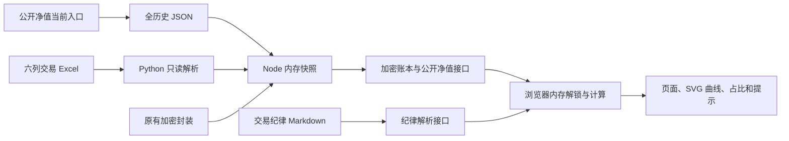

# 基金账本：项目开发与复现说明

> 2026-10-20目录更新：公共工具位于根目录“工具脚本”；全部临时输出位于根目录“临时文件”且不参与同步。旧目录树中的工具/tmp、网站/tmp均已迁出，定时任务目录保持为空；正式运行配置仍在网站local目录。

版本日期：2026-10-20。本文对应本目录实际源码；所有示例均为虚构或公开数据，不包含真实交易金额、访问口令或密钥。

## 1. 复现目标与边界

本项目是一个本地表格驱动的基金账本网站。前端使用原生 JavaScript、HTML、CSS 和 SVG，不使用 React、Vite、数据库或服务端框架。Node.js 提供本地 HTTP 服务，Python 只读 Excel；私有交易在内存中处理并通过加密接口传给浏览器。

网站范围固定为四只权益基金与两只债基。资料库内其他基金不会自动进入网站。

| 类别 | 代码 | 简称 |
|---|---|---|
| 权益 | 016701 | 银华海外数字经济 |
| 权益 | 006373 | 国富全球科技互联 |
| 权益 | 270023 | 广发全球精选 |
| 权益 | 005698 | 华夏全球科技先锋 |
| 债券 | 006485 | 广发中债1–3年国开行债券指数C |
| 债券 | 006663 | 易方达安悦超短债C |

有两种复现方式：

1. **界面与算法复现**：复制网站源码后启动虚构数据模式；不需要真实交易表、原有加密文件或 Python。
2. **当前项目完整复现**：同时取得项目根目录的公开净值主档、当前入口、六份交易表、来源元数据和原有加密封装，按本文启动本地模式。原始旧工作簿用于留档，不自动回退为当前输入。

文档说明系统结构和实现步骤；源码、依赖文件和输入资料也是复现材料，不能只复制这份文档而省略它们。

## 2. 环境与依赖

本次核验环境：Windows、PowerShell、Node.js **24.19.0**、Python **3.12.14**、openpyxl **3.1.5**。这些是已核验版本，不表示其他版本一定不能运行。

| 依赖 | 用途 | 需要安装的位置 |
|---|---|---|
| Node.js | 启动服务、运行测试、打包和发布 | 系统 PATH 或已有 bundled runtime |
| Python + openpyxl | 本地真实模式只读交易工作簿 | 由 `FUND_PREVIEW_PYTHON` 指定 |
| Three.js | 背景视觉 | 已随 `vendor/three/` 保存，revision 186 |
| GSAP | 页面动画 | 已随 `vendor/gsap/` 保存 |
| GitHub CLI | 读取仓库及发布 Pages | 仅云端同步时需要 |
| Artifact Tool | 重建公开 CSV/Excel | 仅净值格式导出时需要，网站启动不需要 |

`package.json` 没有 npm 依赖安装项，网站源码和 vendored 文件齐全时不需要运行 `npm install`。请一并保存 vendor 内的许可证。

在全新 Windows 环境中，可先安装上述已核验的 Node.js、Python，再创建独立 Python 环境：

```powershell
cd 'C:\项目位置\AI 投研\fund-trade-web'
py -3.12 -m venv .venv
.\.venv\Scripts\python.exe -m pip install openpyxl==3.1.5
$env:FUND_PREVIEW_PYTHON = (Resolve-Path '.\.venv\Scripts\python.exe').Path
node --version
& $env:FUND_PREVIEW_PYTHON -c "import openpyxl; print(openpyxl.__version__)"
```

环境变量只作用于当前终端。使用独立 Python 时，从设置该变量的同一个终端启动服务。现有 `启动网站.cmd` 优先使用用户目录下的 bundled Node，再回退到系统 `node`；Python 则由服务端按环境变量或默认 bundled 路径寻找。

## 3. 必须保持的目录关系

服务端通过 `scripts/site-files.mjs` 推导路径：网站目录为 `PROJECT_ROOT`，网站的父目录为 `WORKSPACE_ROOT`。网站必须与“基金”“公共资料”同级。网站自身的运行数据统一放在 `fund-trade-web/local/`，由 `scripts/sync-local.mjs` 从工作区镜像生成（启动和打包时自动刷新），不直接读取 `公共资料/`；交易工作簿与净值主档仍留在各基金目录。

```text
AI 投研/
├─ AGENTS.md                         项目协作与隐私规则
├─ 项目整理规则.md
├─ 交易纪律.md                       本地纪律文字的唯一实时入口
├─ 基金/
│  ├─ 持仓基金/
│  │  └─ 六位代码_基金简称/
│  │     ├─ 六位代码_交易记录.xlsx       网站当前交易输入
│  │     ├─ 六位代码_债基交易账本.xlsx   仅债基
│  │     ├─ 六位代码_单笔交易自动计算_双模式_模板*.xlsx
│  │     ├─ 历史净值/
│  │     │  ├─ 六位代码_全部历史净值.json
│  │     │  ├─ 六位代码_全部历史净值.csv
│  │     │  └─ 六位代码_全部历史净值.xlsx 仅原先已有需求的基金
│  │     └─ PDF报告/                    该基金全部 PDF 报告
│  └─ 观察基金/
│     └─ 六位代码_基金简称/             与持仓基金同结构，不参与网站展示
├─ 公共资料/
│  ├─ 历史净值/全基金历史净值当前入口.json
│  └─ 工具/
│     ├─ compact_nav_formats.mjs
│     ├─ organize_nav_history.py
│     └─ tmp/
│        ├─ 交易记录六列整理/metadata.json
│        └─ 债基截图接入_20261019/metadata.json
├─ 定时任务/                         原配置保持独立，不由网站启动修改
└─ fund-trade-web/
   ├─ index.html、manifest.webmanifest、package.json
   ├─ src/                           浏览器模块与样式
   ├─ scripts/                       本地服务、表格读取、打包和发布
   ├─ tests/                         Node 内置测试框架
   ├─ assets/                        图标 SVG
   ├─ vendor/                        Three.js 与 GSAP
   ├─ local/                         网站运行数据（从 交易纪律.md 与 公共资料/ 镜像，已忽略）
   ├─ data/                          原有账户密文、静态公开数据
   ├─ docs/                          补充说明
   ├─ tmp/                           日志、虚构测试表及页面核验截图
   └─ dist/                          打包产物，可重新生成
```

不要在单只基金目录重新建立 scripts、交易分析、研究、临时资料、公告或法律文件目录。基金目录只保留交易表格、历史净值和 PDF报告；交易工作簿与 PDF 报告不属于可清理文件。

## 4. 最短启动流程

### 4.1 使用虚构数据复现界面

```powershell
cd 'C:\项目位置\AI 投研\fund-trade-web'
node scripts/serve.mjs --demo
```

浏览器打开 `http://127.0.0.1:4186/`。测试模式在品牌旁显示“测试”，首次生成 `../临时文件/fund-trade-web/demo-tables/` 内的虚构 CSV。`scripts/demo-data.mjs` 负责生成虚构净值和交易；这些文件与真实数据隔离。测试模式的债基接口返回独立生成的空加密账本，不读取真实账户密文。

登录逻辑与本地模式共用 `src/vault.js`；文档不抄写当前有效口令。开发者可阅读 `getDailyCode()` 的规则了解已有解锁机制。测试模式下可修改测试 CSV 验证刷新；不要把它们复制成真实基金主档。

### 4.2 使用真实本地表格

1. 将完整项目资料按第3节目录关系放好，保留原有 `data/ledger.enc.json`、`data/bonds.enc.json`。
2. 确认六只网站基金均有当前交易表；表头和工作表名见第6节。
3. 配好 Python 路径，运行：

```powershell
node scripts/serve.mjs
```

也可双击 `启动网站.cmd`：在后台启动服务，完成来源校验和健康检查后自动打开浏览器；关闭启动窗口不会停止网站。重复双击会复用已经运行的真实模式服务。默认网址为 `http://127.0.0.1:4186/`，只监听 `127.0.0.1`。启动状态、标准输出和错误日志统一位于 `临时文件/fund-trade-web/logs/startup-*`。端口被其他程序占用或启动失败时，不会提前提示成功。

使用 `powershell.exe -NoProfile -ExecutionPolicy Bypass -File scripts/start-local.ps1 -NoBrowser` 可只启动并检查、不自动打开浏览器；可用 `-Port 4187` 指定端口。`/__local/health` 只返回服务身份、模式和是否就绪，不包含账户资料。首次从旧版升级时，需要先停止原来的前台服务。

更换端口：

```powershell
$env:PORT = '4187'
node scripts/serve.mjs
```

用 `node scripts/serve.mjs` 前台启动时，按 Ctrl+C 停止服务；双击入口启动的后台服务可在任务管理器中按对应Node进程停止。编辑前端源码后刷新浏览器；修改服务端脚本需要停止并重启 Node。只编辑并保存表格时通常不需要重启。

## 5. 系统结构与请求流程



本地模式没有 Excel 写入接口。改变网页中的显示模式、选点或折叠，不会改写交易表。

### 5.1 HTTP 接口

全部响应设置 `Cache-Control: no-store`。静态资源来自明确白名单，不直接暴露整个工作区。

| URL | 内容 | 产生位置 |
|---|---|---|
| `/`、`/app.js`、`/styles.css` | 页面及浏览器模块 | `site-files.mjs` 映射到实际 src 文件 |
| `/data/version.json` | 数据修订哈希和来源状态 | 权益与债基快照修订组合 |
| `/data/ledger.enc.json` | 四只权益基金交易密文 | `live-data.mjs` |
| `/data/bonds.enc.json` | 两只债基交易、推算持仓及批次密文 | `live-bond-data.mjs` |
| `/data/nav/六位代码.json` | 网站四只权益基金的全历史公开净值 | `adaptNav()` |
| `/data/discipline.json` | 已解析纪律文字及修订号 | `discipline-source.mjs` |

未知静态路径返回404；数据来源暂不可用返回503。服务器不会因为读取失败而自动换成虚构数据。

### 5.2 启动和自动刷新

每次启动先读取并核验当前来源。运行后，网页约每5秒检查修订；Node 使用文件大小、修改时间等指纹缓存快照，文件未变时不会每5秒重新解析全部 Excel。

表格保存、主档或入口变化会触发新快照。读取前后再次比对文件状态，避免把保存中的半份文件当作完整来源。来源错误时不发布新快照，页面保留原有效数据，后续检查可重试。

GitHub Pages 为静态站点，不能访问用户电脑的 Excel，也不能调用本地 Python。云端数据要经过重新打包和同步后才更新。

## 6. 输入数据格式

### 6.1 全历史净值主档

当前路径只以 `公共资料/历史净值/全基金历史净值当前入口.json` 为准，网站运行时读取它的镜像 `fund-trade-web/local/nav-index.json`。入口每项至少包含 code、name、records、first_date、last_date、json_path，另外记录 CSV/Excel 路径与 SHA-256。

虚构的最小主档示例：

```json
{
  "code": "016701",
  "name": "公开基金名称",
  "count": 2,
  "first_date": "2026-01-05",
  "last_date": "2026-01-06",
  "rows": [
    {"date":"2026-01-05","nav":"1.0000","accumulated_nav":"1.0000","daily_growth_pct":null},
    {"date":"2026-01-06","nav":"1.0100","accumulated_nav":"1.0100","daily_growth_pct":"1.00"}
  ]
}
```

日期必须合法、唯一、升序；净值大于0；count和首末日期一致。主档数值字符串用于保留原始精度。网站适配器生成数值 nav 供绘图，原字符串保存在 navRaw 等字段。

CSV及Excel统一仅三列：**日期、净值、日增长率**。CSV为带BOM的UTF-8，增长率示例 `1.00%`；Excel日期为真实日期、增长率为数值比例并用百分比格式显示。原始缺值留空，不用0替代。JSON继续保留累计净值和来源。

270023的官网主序列与第三方待官网复核记录必须分开。补充记录保存在 JSON 的 supplementary_rows，已有Excel另表保存；不混入主CSV和官网曲线。

### 6.2 六列交易工作簿

文件：对应基金根目录的 `<代码>_交易记录.xlsx`。工作表名严格为 **交易记录**；第一行严格按以下顺序：

| 列 | 字段 | 读入约定 |
|---|---|---|
| A | 交易日期 | 原始下单日期，Excel日期或 `YYYY-MM-DD` 文本 |
| B | 成交净值 | 正数；未知留空 |
| C | 确认份额 | 正数；保留原始精度 |
| D | 交易类型 | 买入或卖出 |
| E | 金额 | 原始表格交易金额；未知留空 |
| F | 手续费（元） | 非负数；确实无费用才填0 |

定投、转换转入在六列表中归买入，转换转出归卖出。进行中、撤单、失败不能伪装成已确认成交；旧工作簿和截图保留原始含义。表格没有确认日和状态列，不能仅凭填满六列声称新核实了历史成交。

读取器同时以 `data_only=False/True` 打开工作簿，公式仅使用 Excel/WPS 已保存的缓存数值，不运行公式。公式没有缓存或结果出错时留空并保持待补全。没有成交字段时，不凭公开净值或默认费率补造。

网页份额统一显示两位小数；存储值与计算使用的精度保持原样。不要把显示四舍五入后的份额写回表格。

### 6.3 来源元数据与编辑后的状态

权益来源元数据位于 `fund-trade-web/local/ledger-metadata.json`，债基来源位于 `fund-trade-web/local/bond-metadata.json`。它们保存工作簿校验和、来源行号、原始交易类型和确认状态等追踪信息。

元数据以工作簿SHA-256绑定。手动保存导致校验和变化后，旧行号来源标记不能继续冒充当前确认状态，完整数值转为沿用表格的推算状态。当前交易行数和内容以表格为准，债基不再自动追加旧网站加密备份中的进行中订单。

债基新增未完成的行可保留为待补全，包括日期尚未填写的草稿行；整页不会因为这类草稿而消失。待补全行保留展示但不计持仓。日期有值却格式非法、表头错误或文件损坏仍属于数据错误，应修正后保存。

## 7. 计算规则

### 7.1 权益账本

`src/engine.js` 是纯函数计算器。输入交易列表，输出逐笔状态、汇总和错误；无文件、网络、数据库操作。支持买入、定投、卖出、红利再投、现金分红、转换转入。

持仓份额按交易增减，买入总支出、手续费、净值与份额相互核对。默认核对容差为0.1元；卖出不得超过已持份额。遇到无效已成交行后，后续交易阻塞，汇总暂停。待确认和撤单等状态先排除。

到账分配有利润优先、本金优先两种展示模式；它们改变已回收本金与已提取利润的分配，不改变实际现金流和份额。逐笔FIFO收益由 `transaction-performance.js` 独立计算。金额主要按分处理，份额内部保留六位精度，与页面显示两位相区分。

没有完整交易表、存在待补全历史成交或账本错误时，不生成完整权益账户汇总。交易日期来自下单日时，不生成冒充净值确认日的图上交易节点。

### 7.2 债基持仓和持有期

`scripts/bond-ledger.mjs` 从完整记录重建FIFO剩余批次，不推断期初余额。买入成本沿用表格金额；卖出按份额依次消耗批次及对应成本。剩余份额乘最新公开净值为估算持仓，减剩余成本为持有收益。

待补全、进行中、撤单和失败行不计入推算；页面明确提示“按完整记录推算”和“待补全记录未计入”。这不等于截图已经证明全部历史及期初持仓。完整成交发生在当前估值日之后、卖出超过已有份额、必要字段无效或净值不可用时暂停计算。

收益率为：持有收益÷剩余成本。实际确认日期缺失时，批次使用交易日推算自然日持有时间，进度条标注日期依据，不能视为准确的赎回费计费日。页面费率是规则展示，不用于反推真实历史手续费。

### 7.3 全部基金占比和持仓上限

`src/portfolio-allocation.js` 的分母为网站四只权益基金与两只债基的当前持仓之和，排除自由现金流和未成交订单。每只基金占比=其当前持仓÷此合计。任一必需持仓不可用、重复、非法或合计为0时显示待核验，不用0代替未知。

每个权益基金页面的基本信息显示“占总持仓比例”。金额隐藏时可以显示经过四舍五入的占比。

纪律1：美股含量低于40%的基金，其持仓上限为总持仓的10%；相关基金页及首页原因中显示当前占比与上限。高于上限提示降低；已经在上限以内时不因这条规则加仓。美股占比与基金持仓占比分母不同：前者来自报告的美国上市股票占基金净资产，后者来自账户全部基金持仓。

纪律阈值和文字由 `交易纪律.md` 提供（网站读取镜像 `fund-trade-web/local/discipline.md`），解析不确定时不擅自补默认数值。网站只展示提示，不下达实际交易。

## 8. 页面与曲线交互

路由使用URL哈希：`#/`为首页纪律，`#/fund/六位代码`为基金页，`#/bonds`为债基；`?section=...`用于定位对应规则或区块。

桌面宽度从761px起，主要板块首次默认展开，导航保持顶部；仍可手动收起。逐笔交易保留单独点击展开，权益交易整块标题、日期和盈亏区域都可点击。基金名称后显示“已持有X天”。

净值图由 `nav-chart.js` 输出SVG与HTML覆盖层，`nav-interaction.js` 通过事件委托响应交互。以下两点区间比较仅在电脑端（视口宽度至少761px）启用：

1. 首次点击记录A点。
2. 鼠标移动选择B点，按 `B净值÷A净值−1` 实时显示区间涨跌幅。
3. 再次点击立即清空，不固定终点；下一次点击可重新开始。
4. 区间栏左侧上行为自然日天数，下行为起止日期，右侧为涨跌幅；不显示清除按钮及固定区间说明。
5. 悬停点日期和距左右边界天数在同一水平线上。桌面字体14px；距离太短时隐藏容易重叠的天数或边界文字。
6. 左右方向键、Home/End可定位，回车选起点或清空，Escape清空。

只比较实际公布净值或明确标识的估值；“待更新”日期不补净值、不计算涨跌幅。区间天数按日期差计算，不等于净值记录条数。反向选点仍以A点为基准。

手机端（不超过760px）保留触摸查看单点净值、日期与当日涨跌，不建立A/B区间，也不显示区间涨跌幅栏、选点圆及辅助线。即使使用外接键盘也不会建立区间；从电脑宽度缩窄到手机宽度时立即清空旧选点。X轴两端日期和当前查看日期改为11px，两侧自然日天数为10px，轴外间距由12px改为9px；电脑端仍为14px。320px、390px窄屏需检查日期遮让和横向溢出。

交易节点按实际来源区分：有来源备份净值日期的记录优先使用该日期及原记录净值，保留历史估算状态；只有下单日期的记录，只在该日确有公开净值时放到曲线上，显示虚边并注明“下单记录，非成交净值”。不把下单日改成成交日，不插值造净值，也不把休市日自动顺延到下个工作日。撤单、失败、待确认、被阻断和缺少可定位净值的记录不生成标记。买入仍为蓝色实心圆，卖出为空心圆；点径增至9px并加轮廓，覆盖层置于曲线与普通净值点之上；图例可换行。

估值日期由 `getEstimateTargetDate()` 按北京时间选择最近一个已结束的工作日：例如2026-10-18（周日）和19日（周一）都指向16日（周五），20日指向19日。输入标题为“最近工作日估值”。`buildEstimatedNav()` 与保存校验排除周六、周日的手工估值，旧版保存的周末估值在读取时过滤，不再进入曲线或估值链；正式来源的特殊日期净值保留原样。这里只做周末校验，不冒充完整交易所休市日历，其他休市日应留空并使用最新已公布净值。

Y轴按当前可见净值自动适配上下界，数值和视觉刻度均等分。成本或交易节点超出范围时使用边缘提示，不扩大Y轴压扁曲线。“最近上涨/下跌”合并为按最新转折选择的单一按钮。

来源长说明、历史总数、核验时间等用户要求删除的页面文本已隐藏；原始来源信息继续保存在输入和接口中。

## 9. 模块对应表

| 模块 | 职责 |
|---|---|
| `src/app.js` | 解锁、路由、页面组合、交互与状态 |
| `src/funds.js` | 基金目录与网站可见四只代码 |
| `src/engine.js` | 权益账本及双模式分配 |
| `src/transaction-performance.js` | 逐笔FIFO收益归因 |
| `src/holding-duration.js` | 当前连续持有期 |
| `src/bond-model.js`、`bond-store.js` | 债基金额校验、会话和现金流 |
| `src/bond-holding-duration.js` | 债基批次天数及分布 |
| `src/portfolio-allocation.js` | 全基金占比与低美股基金持仓上限 |
| `src/us-exposure.js`、`region-data.js` | 公告地区比例及美股门槛 |
| `src/nav-range.js`、`nav-slider.js` | 时段、最近走势、范围滑块 |
| `src/nav-chart.js`、`nav-interaction.js` | SVG坐标、刻度、悬停与区间比较 |
| `src/nav-annualized.js` | 复合年化及止盈、加仓信号 |
| `src/nav-estimates.js`、`nav-estimate-store.js` | 估值生成、校验及本机保存 |
| `src/discipline.js`、`discipline-sync.js` | 规则解析、回退与自动刷新 |
| `src/vault.js` | 浏览器内存解锁及加密会话 |
| `src/styles.css`、`redesign.css` | 基础样式与投资观测站界面，包含桌面及320像素以上手机布局 |
| `scripts/live-data.mjs` | 当前入口、权益工作簿、快照与加密 |
| `scripts/live-bond-data.mjs` | 债基表格、公开净值与加密快照 |
| `scripts/local-workbooks.py` | 六列表只读解析和公式缓存 |
| `scripts/bond-ledger.mjs` | 债基FIFO推算 |
| `scripts/site-files.mjs` | 路径根、静态和发布白名单 |
| `scripts/serve.mjs` | HTTP服务与测试/真实模式分支 |
| `scripts/prepare-account-data.mjs` | 发布前从六份表格刷新密文 |
| `scripts/package-site.mjs` | 生成白名单静态产物dist |
| `scripts/publish-pages.mjs` | GitHub Git API提交gh-pages |
| `scripts/publish-local.mjs` | 一键检查、打包及发布编排 |

## 10. 加密、浏览器保存与隐私

既有账户密文为version2，使用AES-256-GCM、12字节随机IV、PBKDF2-SHA256及600000次迭代；保留原有包装密钥以支持会话刷新。当前机制的解锁值空间有限，不能把“已加密”理解为适合公开保存任意敏感数据的强保密承诺。

真实表格由Python子进程通过标准输入/输出管道与Node交换，输出由父进程捕获到内存，不应手动运行读取器并把结果打印到终端。日志只包含固定错误、状态和计数。解密后的交易不写入浏览器localStorage；关闭或加锁释放会话，跨北京时间日期需重新解锁。

本机localStorage仅保存主题、公开净值估值，以及经会话密钥加密的自由现金流等既有记录。自由现金流独立于基金总持仓分母。浏览器清理站点数据会清除这些本机设置，但不会删除Excel。

网站默认隐藏金额和份额。调试时不要输出state、交易内容、密钥或完整私有接口明文；截图核验应保持金额隐藏。

项目默认不上传业务原表。**2026-10-20本次例外**：用户在获知 `oooo0h/Investment` 为公开仓库后，二次确认原样上传原始交易表格。本次原表可进入指定仓库；此授权不包含原始账户截图、密码和密钥，也不改变对话与日志隐藏金额的要求。

## 11. 公开净值维护流程

净值读取与联网更新是两件事。启动网站只读取本地文件，不自动向基金公司下载最新净值。

1. 读取项目规则和当前入口，确认基金代码、份额与实际净值日。
2. 使用公共工具获取公开数据；新日期合并进已有JSON，按日期去重并保留原精度。
3. 对照旧主档检查日期未丢失、来源和修订；270023官网与待复核补充保持独立。
4. 按表格技能准备Artifact Tool依赖与操作标记，运行 `工具脚本/compact_nav_formats.mjs --stage`。
5. 读回候选CSV与已有Excel，核对三列、所有数值、行数及首末日期，再运行 `--publish` 原子替换同名表格。
6. 运行 `工具脚本/organize_nav_history.py --index` 核对并刷新全基金和四基金入口及SHA-256。
7. 检查网站下一轮刷新；需要更新云端时另行执行打包和发布。

公开格式导出需要Artifact Tool环境，独立机器未准备该环境时可先使用已核验好的JSON/CSV/Excel，不影响网站运行。不要运行旧历史整理脚本重建已取消的目录。

## 12. 测试与验收

在网站目录执行：

```powershell
node scripts/test-local.mjs
```

此入口自动收集全部 `tests/*.test.mjs`，使用Node内置测试框架，不需要额外测试包。`npm test`仍保留全部测试入口。涉及工作簿的回归测试使用临时虚构数据，需要已配置Python/openpyxl，不读取真实账户文件。

测试入口把子进程的临时目录设为 `../临时文件/fund-trade-web/test-runtime/`，避免Windows受限环境中系统临时目录不允许替换文件；不修改系统或全局环境变量。

必须覆盖：账本双模式及FIFO、金额与份额误差、待确认排除、表格缓存公式、日期和路径越界、加密接口、来源变化、草稿行、旧订单不追加、占比分母、10%边界、电脑端曲线两次点击和悬停、手机端禁用区间但保留单点查看、周末估值过滤、交易日期口径、空数据、键盘、发布白名单及失败回滚。

手工验收：

- 桌面页面主要区块默认展开，移动端无横向溢出。
- 交易整块标题可展开，份额显示两位，计算输入未变。
- 电脑端A点点击后移动查看实时涨跌幅，再点击清空；日期和天数同一水平线。手机端点击或回车不出现A/B区间，保留单点查看。
- 320px、390px、桌面宽度分别验收X轴字号、日期重叠和节点可见性；10月18日无手工估值节点，有来源净值日期和仅有下单日期的标记清楚区分。
- 每个基金基本信息显示占总持仓比例，低美股基金显示10%上限提示。
- 债基记录数等于当前表格非空行数；新增未完成行仍能打开页面，待补全不计持仓。
- 保存表格后自动刷新，无需改前端代码；读入异常不误报密码错误。
- 截图和日志不显示账户金额。

## 13. 打包、GitHub与云端复现

源码仓库和网站产物是两层：`main`保存可复现源码及授权资料；`gh-pages`保存可直接部署的静态产物。当前目标为 `oooo0h/Investment`，站点地址为 `https://oooo0h.github.io/Investment/`。

项目根目录新增 `一键同步本地文件到GitHub.cmd`，双击后由公共脚本 `工具脚本/github_sync.py` 执行完整项目镜像：除根目录 `临时文件/` 及 Git 元数据外，正式文件的新增、修改、重命名和删除均同步至 `main`，并核验路径与内容完全一致。窗口显示4步、等待状态与明确的“同步成功”，日志仅放在 `临时文件/GitHub完整同步/`；没有变化时不建立空提交。支持 `--check` 只检查，以及中断后在原核验文件树与云端父版本未变时继续上传；冲突、暂存或未核验变化会停止。此入口只同步项目仓库，网站上线继续使用网站目录的Pages发布入口。详情见 `工具脚本/README_GitHub同步.md`。

网页本地模式动态读取表格，Pages模式读取静态密文和公开净值。仅上传HTML/CSS不会刷新云端账户数据。

发布检查：

```powershell
node scripts/publish-local.mjs --check
```

完整网站发布：

```powershell
node scripts/publish-local.mjs
```

一键入口为 `一键发布到GitHub Pages.cmd`。完整流程为：验证GitHub CLI与仓库权限→六份表格读入校验→保留原包装密钥并刷新两份账户密文→从当前全历史主档打包公开净值→白名单生成dist→提交gh-pages→核验Pages状态。

窗口按7个中文步骤显示当前进度。内部接口请求、耗时等诊断只写入 `临时文件/fund-trade-web/logs/publish-*.log`。第7步由 `scripts/verify-pages.mjs` 等待本次提交对应的Pages构建成功，再逐项比较线上核心界面、公开净值和账户密文的Git对象哈希；构建失败、版本被其他发布替换或5分钟内未确认时均不显示“发布成功”。超时会明确提示“文件已上传，尚未确认上线”，本次检查已结束，不自动重复上传。检查模式单独显示“检查完成”，窗口最后提示按任意键关闭。

基金页的本金/利润优先按钮下方会说明当前分配是否存在差异。现有卖出无可优先提取利润时，两种模式可得到相同结果；只有分配发生差异时，剩余本金、已提取利润和持有收益率才可能改变。切换分配模式不改变原始交易、份额、市值和累计总收益。

仅修改界面和公开净值且明确保留线上旧账户时使用 `--public-only`；它不会将最新本地交易带到云端。底层 `publish-pages.mjs` 默认保留远程账户文件，只有明确参数 `--include-account-data` 才上传账户密文。

打包过程拒绝额外文件、链接及明文账户字段。原始XLSX上传属于本次另行确认的源码/资料同步，不加入网站静态白名单。不要将整个工作目录直接当作静态网站发布。

新机器可从main取回源码、公开主档及本次授权的表格，保持目录关系后运行真实模式；先使用虚构模式确认环境也可以。不得从公开说明中重造真实密钥；如原加密封装丢失，需由所有者恢复备份或重新建立授权密钥。

同步完成应核验：main/gh-pages提交号、源码和业务原表SHA-256、公开净值条数/首末日期、Pages构建结果和线上资源可读取性。发布错误仅输出脱敏诊断，不打印GitHub令牌或账户接口明文。

## 14. 故障定位表

| 现象 | 优先检查 | 处理 |
|---|---|---|
| 启动即提示本地数据不可用 | Python路径、openpyxl、当前入口、六列表、原密文 | 修复来源后重启；不换成测试数据 |
| 密码正确仍无法解锁 | 接口是否503、公式缓存、文件是否正在保存 | 数据错误和口令错误分开检查；不打印密文解密结果 |
| 新增债基行后看不到汇总 | 草稿/待补全行或完整成交超出可用净值日 | 草稿保留展示但不计持仓；按页面推算提示核对 |
| 某行未计持仓 | 日期/成交字段缺失或来源冲突 | 填入实际确认资料，不凭缺值猜测 |
| 交易笔数比表格多 | 是否混入旧备份或本机旧覆盖 | 当前实现只使用表格，不追加旧进行中订单 |
| 全基金占比待核验 | 六只基金是否都有有效当前持仓 | 修正缺失输入；不把未知当0 |
| 修改公式后数值仍空 | Excel/WPS是否重算并保存缓存 | 在表格软件重算后保存，等待刷新 |
| 改了服务端脚本仍是旧行为 | Node进程未重启 | 停止旧进程再启动 |
| 云端与本地不同 | 是否只发布了界面、云端密文是否更新 | 按完整发布流程同步并核验提交 |
| 端口被占用 | 已有服务或其他程序 | 使用已有正确服务或显式换PORT |

## 15. 后续开发约定

先读根目录规则。界面改动只调整格式，不降低计算精度。计算模块保持纯函数，回归测试使用虚构数据。新增浏览器模块必须同步 `site-files.mjs` 白名单，否则本地404、打包也缺文件。

新增基金需要显式修改范围、公开净值入口、交易适配、地区报告与测试；不能因为目录里出现新基金就自动接入。报告地区比例必须注明报告截止日、公告日及分母，不能把上市市场分类当成公司业务地域。

每次改动按“输入→读取→计算→页面→刷新→发布”检查完整链路。先完成本地验收，再按用户授权同步云端。定时任务的任何变更另遵循 `工具脚本/自动任务同步规则.md`，本文没有创建或修改调度。

## 16. 2026-10-20 图表修订复现

本轮涉及 `src/nav-estimates.js`、`nav-estimate-store.js`、`estimate-panel.js`、`nav-chart.js`、`nav-interaction.js`、`app.js`、`redesign.css` 和 `index.html`；入口与相关模块缓存版本为 `20261020-nav-dates-trades`。不修改交易工作簿、正式净值主档或账本计算公式。

专项复现命令（在网站目录运行，日志重定向到父级临时目录）：

```powershell
node --test tests/nav-estimates.test.mjs tests/nav-estimate-store.test.mjs tests/nav-display.test.mjs tests/nav-dates-trades.test.mjs tests/nav-chart.test.mjs tests/nav-interaction.test.mjs tests/site-files.test.mjs *> ../临时文件/fund-trade-web/test-nav-dates-trades.log
```

新增回归使用虚构公开数值，检查周末/北京时间跨日、旧估值过滤、周末输入拒绝、来源净值日期与下单日期分别定位、无报价日不造节点、手机不建立区间和缩屏清空电脑选点。`node scripts/package-site.mjs` 生成发布白名单静态文件；源码同步到 `main` 不会自动更新 `gh-pages`，线上显示需再运行一键发布并等到“发布成功”。

本轮验收：专项101项全部通过；全量602项通过582项，20项既有失败与修改前名称完全一致，无新增失败。浏览器核验320px、390px无横向溢出，手机不出现区间面板，1280px电脑端区间比较仍正常。演示截图与测试日志仅保存在根目录临时文件中，不参与Git同步。

## 17. 2026-10-20 交易表追加与唯一主表修订

银华新增交易的确认份额使用同一行 `=E4/B4`、`=E5/B5` 形式，未扣手续费；账本按总支出与净份额核对时会报“买入金额与份额净值不符”，后续记录被阻断，相关汇总暂停。此行为不通过放宽账本核对容差来绕开。

共用读取器 `scripts/local-workbooks.py` 对买入/卖出的份额列中严格同一行 `=E行/B行` 形式（允许空格及绝对引用），在已有有效公式缓存、必要输入完整且手续费为正时，根据六列表现金定义在内存重估：买入份额为 `(金额-手续费)/成交净值`，卖出份额为 `(到账+手续费)/成交净值`，按十进制四舍五入保留六位。源工作簿不改写，输入金额、净值和手续费不变；结果保留估算状态，基金页和逐笔详情明确提示核对实际确认份额。手填确认份额不被替换，任意公式不执行，跨行引用不猜测，缺失/错误缓存仍待确认，来源冲突不覆盖。

该逻辑共用于各基金工作簿，不写基金代码特例；持仓、收益、占比与逐笔FIFO继续经过原账本核对。读取器文件加入快照指纹及修订哈希，读取逻辑变化也能触发新修订，避免表格内容没变时浏览器继续使用旧计算结果。服务端JS修改仍需重启本地服务。前端入口缓存版本为 `20261020-workbook-fee-shares`。

每只基金只保留根目录 `<代码>_交易记录.xlsx` 作为完整有效交易主表。270023与009608的带截至日期旧表已逐笔按日期、买入/定投归一类型和金额核对：有效记录均已包含在固定主表中，旧表完整移至 `临时文件/交易记录旧版归档/2026-10-20/`，保留撤单、关闭等原始证据与路径/哈希恢复索引，固定主表未改写。GitHub同步移除旧路径，临时归档不上传。网站始终只读取固定文件名。

回归命令：

```powershell
node --test tests/workbook-fee-formulas.test.mjs tests/local-sources.test.mjs tests/engine.test.mjs
```

测试仅使用虚构工作簿与数值，覆盖手续费口径、买入/卖出、绝对引用、六位舍入、手填值保留、未知公式与跨行引用、缺失缓存及真实不匹配仍被拦截。真实工作簿验收只在内存计算，输出有效性和错误行号等非金额信息，不保存明文账户快照或截图。

追加记录的兼容性：交易日期列可读取失去日期格式的Excel日期序号，并遵循工作簿1900/1904日期体系。权益表启用草稿读取，未填日期或类型时保留草稿，不使整个数据接口失败；未确认资料不猜测为成交。对于日期晚于最新公开净值日、已有有效金额而仍缺净值或份额的买入/卖出记录，显示为“进行中”，不计入持仓及收益，也不抹去已确认历史的汇总。较早的历史记录缺失、来源冲突、错误公式缓存和真实金额不匹配仍保留拦截。

本轮专项25项全部通过；全量610项通过590项，20项既有失败与修改前名称一致，无新增失败。真实四只权益基金在内存复核均无账本错误，银华公式估算与进行中订单分开显示，未打印或保存实际账户金额。
